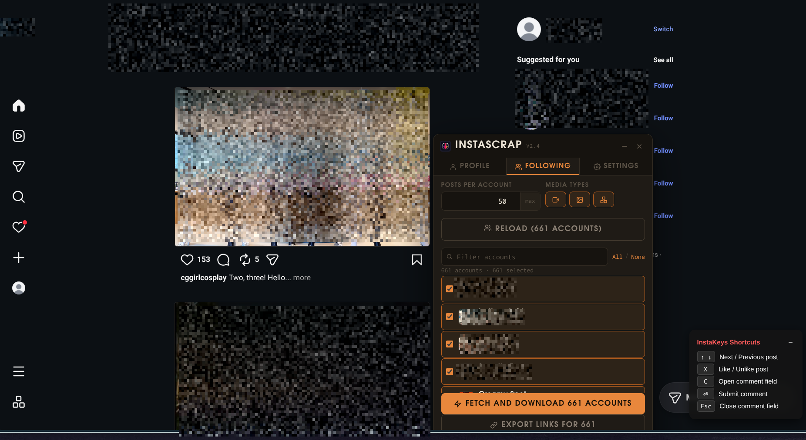

# InstaScrap — Instagram Media Downloader

A Chrome Extension (Manifest V3) that downloads Instagram reels, photos, and carousel albums from any public profile — using your own logged-in session, so zero bot detection.



## How it Works

Instead of scraping with a headless browser, InstaScrap runs **inside** an existing Instagram tab using `chrome.scripting.executeScript` with `world: "MAIN"`. This means it calls Instagram's own internal APIs using your real browser cookies — exactly like the Instagram web app does.

**Dual-feed scanning** — Instagram keeps reels-tab content on a *separate* API endpoint (`/api/v1/clips/user/`) from the main timeline (`/api/v1/feed/user/`). InstaScrap hits both and deduplicates, so you get everything regardless of which tab it lives on.

## Features

| Feature | Details |
|---|---|
| **Reels** | Scans *both* the main feed and the Reels tab — catches everything |
| **Photos** | Downloads JPG at full resolution |
| **Carousel Albums** | Downloads every slide (photo + video) individually |
| **Highest Quality** | Videos and images sorted by pixel area — always max resolution |
| **Date Filter** | Only download posts within a date range |
| **Post Limit** | Set a max number of posts per run |
| **Current Profile** | Auto-detects the Instagram profile open in your browser tab |
| **Download History** | Remembers downloaded post IDs; dims them in the grid on next scan |
| **Skip Downloaded** | Toggle to only queue posts you haven't downloaded before |
| **ZIP Mode** | Bundle everything into a single dated `.zip` file |
| **Live Preview** | Thumbnails appear in real-time as posts are scanned |
| **Organised Output** | Files go to `~/Downloads/InstaScrap/<username>/` |
| **Named Files** | `username_YYYY-MM-DD_shortcode.ext` format |

## Installation

### Option A — Download a release (recommended)

1. Go to [Releases](https://github.com/shiroanon/InstaScrap/releases) and download the latest `InstaScrap-<version>.zip`
2. Extract the ZIP (it creates an `InstaScrap-<version>/` folder)
3. Open Chrome (or Edge / Brave / Chromium) and go to `chrome://extensions` (`edge://extensions` / `brave://extensions`)
4. Enable **Developer Mode** (top-right toggle)
5. Click **Load unpacked**
6. Select the extracted `InstaScrap-<version>/` folder
7. The extension icon will appear in your toolbar — pin it for easy access

### Option B — From source

```bash
git clone https://github.com/shiroanon/InstaScrap.git
```

Then follow steps 3–6 above, selecting the cloned `InstaScrap/` folder.

### Optional local bridge

`bridge_server.py` (stdlib-only Python — no pip installs) forwards scraped data to external apps on `localhost:7432`:

```bash
python3 bridge_server.py   # or `python bridge_server.py` on Windows
```

## Usage

1. **Log in to Instagram** in any Chrome tab (`https://www.instagram.com`)
2. Click the **InstaScrap** extension icon
3. Enter a **@username** — or open a profile in Instagram first and click **📍 from current tab**
4. (Optional) Set date range, media type filters, and post limit
5. Click **Fetch Posts** — thumbnails appear live; already-downloaded ones show a ✓
6. Choose **Individual** or **ZIP Archive** download mode
7. Click **Download** — optionally check *Skip downloaded* to only grab new posts

## Download History

- Post IDs are stored in `chrome.storage.local` keyed by username
- After each download, all queued posts are marked as downloaded
- On the next scan of the same profile, previously-downloaded posts appear dimmed with a ✓ overlay
- Use **🗑 clear history** in the preview header to reset the record for a user
- **Skip downloaded** checkbox (on by default) excludes them from the download queue

## ZIP Mode

- Fetches all media files as blobs directly in the extension popup
- Bundles them with JSZip using `STORE` mode (no double-compression; media is already compressed)
- Downloads as `InstaScrap_username_YYYY-MM-DD.zip`
- A warning appears for batches over 30 files (large in-memory ZIP)

## Notes

- **Private accounts**: Only works if you follow them (same restriction as Instagram itself)
- **Rate limiting**: The scraper adds polite delays between pages (~700ms). If Instagram rate-limits you (HTTP 429), wait a few minutes
- **Reels tab**: The extension automatically scans both the main feed and the `/reels/` endpoint — no need to navigate there manually
- **URL expiry**: Instagram CDN URLs expire after a few hours. Download immediately after fetching
- **Stopping**: Click "Fetch Posts" again while scanning to cancel mid-scan

## File Structure

```
InstaScrap/
├── manifest.json
├── popup/
│   ├── popup.html
│   ├── popup.css
│   └── popup.js
├── background/
│   └── service_worker.js
├── lib/
│   └── jszip.min.js
└── icons/
    ├── icon16.png
    ├── icon48.png
    └── icon128.png
```
